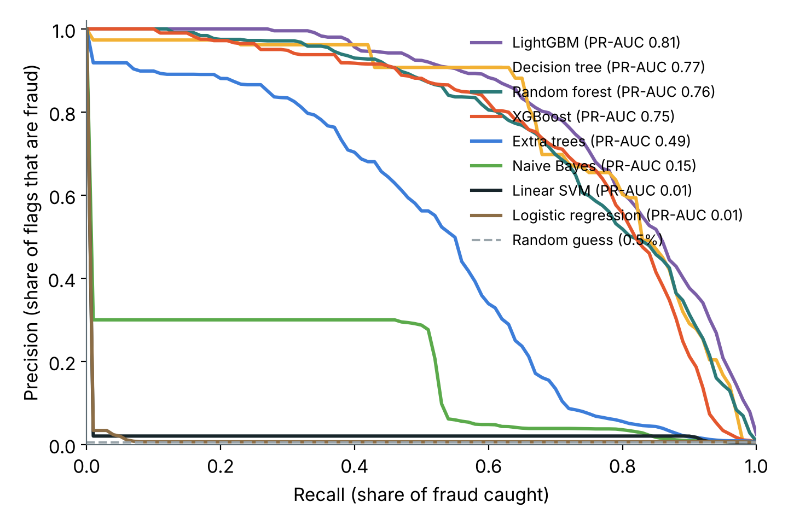

# Credit Card Fraud Detection with Classical Machine Learning
Joshua Francis and Logan Digilormo. Graduate Machine Learning, LSU Shreveport. 

## 1. Introduction
We predict whether a credit card transaction is fraud (binary classification) using classical machine learning (no deep learning). Fraud is rare (1.07% of transactions in our data), so accuracy is misleading: always predicting "not fraud" scores 98.93%. We evaluate every model with both F1 (at a validation-chosen threshold) and PR-AUC (threshold-free).

## 2. Related work
sharmasapna's GitHub project (credit-card-fraud-detection) classifies fraud on Sparkov-generated data. We add engineered customer-history features, time-aware cross-validation, dimensionality reduction (SVD and t-SNE), an eight-model comparison, an ablation study, and a scoring web app. Data generator: Sparkov Data Generation (namebrandon, MIT license), github.com/namebrandon/Sparkov_Data_Generation.

## 3. Data
Generated with the public Sparkov tool (seed 42, 2025-01-01 to 2025-12-31): 877,369 transactions for 998 customers, 9,377 fraud (1.07%). The output has 26 columns (16 customer, 10 transaction). We dropped identifiers (ssn, names, street, city, zip, job, account and transaction IDs, merchant name, generator profile). No full row is repeated; the generator's seed repeats some transaction ID strings across different customers, and we do not use that column. The development period is 2025-01-01 to 2025-11-30 (745,763 rows, 1.17% fraud); the test month is 2025-11-30 to 2025-12-31 (131,606 rows, 0.50% fraud). The test set is the last 15% of rows in time order.

### 3.1 Is the simulated data believable?
Sparkov is a rule-based simulator, so we read how it creates fraud (the profile files and datagen_transaction.py in its repository) and checked that our data matches. Each customer gets one short burst of fraud, about a day long, drawn from a separate fraud profile in place of the normal profile: many more purchases per day, a different category mix (more online shopping, groceries, and miscellaneous online purchases), larger amounts, night-time shopping, and no travel. Normal purchases on the burst days are removed.

| Check on our generated data | Normal | Fraud |
|---|---|---|
| Customers with a fraud burst | n/a | 984 of 998 |
| Fraud purchases per customer | n/a | 9.5 on average (range 2 to 16) |
| Median amount | $44 | $500 |
| Share of purchases at night (10pm to 6am) | 30% | 86% |
| Most common category | shopping pos (10%) | shopping net (24%) |
| Median distance from home (miles) | 48.9 | 49.1 |

The data behaves as the generator documents, which is an internal check of the simulator. It does not show that real fraud looks like this. The fraud rate is a setting (one burst per customer), not a measurement, and published real-world card datasets are much less fraudulent (for example, the widely used ULB/Worldline credit card dataset has about 0.17% fraud, 492 of 284,807 transactions, as reported by Grover et al. 2022). We therefore use the data to compare methods under identical conditions, not to estimate real-world accuracy.

The check also explains the drift in the fraud rate. Fraud per day is flat through the year, while normal volume per day jumps in December because Sparkov weights the holiday weeks (Nov 30 to Dec 31) more heavily in its profile files:

| Month | Transactions | Fraud rate | Fraud per day | Normal per day |
|---|---|---|---|---|
| 2025-01 | 49,833 | 1.57% | 25 | 1,582 |
| 2025-02 | 45,827 | 1.63% | 27 | 1,610 |
| 2025-03 | 67,677 | 1.14% | 25 | 2,158 |
| 2025-04 | 64,216 | 1.22% | 26 | 2,114 |
| 2025-05 | 72,499 | 1.09% | 26 | 2,313 |
| 2025-06 | 80,948 | 0.95% | 26 | 2,673 |
| 2025-07 | 81,742 | 0.98% | 26 | 2,611 |
| 2025-08 | 86,536 | 1.01% | 28 | 2,763 |
| 2025-09 | 63,190 | 1.27% | 27 | 2,080 |
| 2025-10 | 66,694 | 1.21% | 26 | 2,125 |
| 2025-11 | 69,211 | 1.18% | 27 | 2,280 |
| 2025-12 | 128,996 | 0.49% | 20 | 4,141 |

The lower December fraud rate is therefore an artifact of the generator. It shifts score distributions between the development period and the test month, so a threshold chosen on the development months can be less well matched to the test month.

## 4. Methods
**Features (31 inputs).** Base (amount, age, city size, 14 category columns), time (hour, weekday, weekend, night), distance (haversine miles from home to merchant), and history (time and distance since the previous purchase, implied speed, amount versus the customer's past mean and z-score, purchases in the last hour and day, first-transaction flag). History features use only earlier transactions of the same card.

**Models and loss.** Eight classical models. Josh: logistic regression, decision tree, random forest, extra trees. Logan: XGBoost (gradient boosting), LightGBM, linear SVM (probability-calibrated), Gaussian Naive Bayes. Wherever a model has a loss function, it is cross-entropy; the linear SVM trains on hinge loss and is then calibrated by minimizing log loss (Platt scaling), and Naive Bayes has no loss (maximum likelihood). All use class weighting except Naive Bayes.

| Model | Loss or objective |
|---|---|
| Logistic regression | binary cross-entropy (log loss) |
| Decision tree | entropy split criterion (cross-entropy) |
| Random forest | entropy split criterion (cross-entropy) |
| Extra trees | entropy split criterion (cross-entropy) |
| XGBoost (gradient boosting) | binary cross-entropy (binary:logistic) |
| LightGBM | binary cross-entropy (objective=binary) |
| Linear SVM (calibrated) | hinge loss, then log-loss (Platt) probability calibration |
| Naive Bayes | maximum likelihood (no loss function) |

**Validation.** Time-aware, expanding-window 5-fold cross-validation on the development period, split into six chronological chunks. Fold k trains on chunks 1..k and validates on chunk k+1, so models never train on the future. Hyperparameters were chosen by mean PR-AUC across folds, and each model's decision threshold maximizes F1 on the pooled out-of-fold predictions. Each model was then refit on the whole development period and evaluated once on the test month. We report F1 and PR-AUC for every fold and for the test month.

**History features and leakage.** For every purchase we describe the customer's own past: the amount compared with their typical amount so far (ratio and z-score), purchases in the last hour and day, time since the previous purchase, and implied travel speed. A feature may only use purchases that happened strictly before the one being scored. This is enforced three ways (src/fraud/features.py). Running totals are cumulative sums minus the current row, so a purchase never counts toward its own average. Counts for the last hour and day search earlier timestamps only (searchsorted). A customer's first purchase has no history and is filled with zero. The split and the cross-validation folds are also in time order, and the scalers and the SVD are fit on training data only. Leakage would make the scores look better than any deployed system could achieve.

**Class imbalance.** Fraud is 1.17% of development transactions, so always answering "not fraud" is 98.9% accurate. We keep the data imbalanced and make the models care about the rare class in four ways. (1) Class weights: logistic regression, the decision tree, random forest, extra trees, and the SVM use balanced class weights (a fraud example counts about 84 times more; the forest and extra trees recompute the weights inside each tree's sample). XGBoost and LightGBM use scale_pos_weight, which is a tuned setting (we tried 1, 3, 9, 20, 40 for XGBoost and 1, 3, 9 for LightGBM, and cross-validation picked 40 and 3; the square root of the class ratio is about 9). Naive Bayes has no weighting. (2) Metrics for rare events: PR-AUC and F1, not accuracy. (3) A tuned threshold: each model's cutoff maximizes F1 on the pooled out-of-fold predictions instead of the default 0.5. (4) Realistic evaluation: validation and test data keep the real fraud rate; only the training loss changes. We did not use resampling (SMOTE or undersampling). Weighted scores rank transactions well but are not calibrated probabilities.

**Hyperparameter tuning.** Grid search with the same time-aware folds: every combination in the grid is trained on the earlier chunks and scored on the next, and the combination with the best mean PR-AUC wins (src/fraud/cv.py; the grids are in src/fraud/common.py). The test month is never used for tuning. Our first pass tried two to four combinations per model; the final grids are larger and add the fraud weight, number of trees, and sampling settings for the boosted models. The boosted models were searched in three rounds, each finer grid centered on the previous winner, because their best values kept landing at the edge of the previous grid; we stopped after three rounds, and the last winners are still at the edge of their grid. The random forest and extra trees now use 100 trees instead of 60.

| Model | Settings searched | Combinations | Winner | CV PR-AUC, first pass to final |
|---|---|---|---|---|
| Logistic regression | C: 0.01, 0.1, 1.0, 10.0 | 4 | C 0.1 | 0.13 to 0.13 |
| Decision tree | depth: 8, 12, 16; min leaf: 20, 50, 200 | 9 | depth 12, min leaf 200 | 0.46 to 0.46 |
| Random forest | depth: 12, 16, 20; min leaf: 5, 10, 20 | 9 | depth 16, min leaf 20 | 0.71 to 0.72 |
| Extra trees | depth: 16, 20, 24; min leaf: 5, 10, 20 | 9 | depth 20, min leaf 10 | 0.47 to 0.50 |
| XGBoost (gradient boosting) | fraud weight: 1.0, 3.0, 9.0, 20.0, 40.0; depth: 4, 6, 8, 10; min child: 2, 5, 10, 20; colsample: 0.3, 0.5, 0.8; subsample: 0.5, 0.8; trees: 20, 30, 40, 50, 100 | 150 | fraud weight 40.0, depth 10, min child 10, colsample 0.5, subsample 0.5, trees 30 | 0.51 to 0.69 |
| LightGBM | fraud weight: 1.0, 3.0, 9.0; leaves: 7, 15, 31, 63, 127; min child: 100, 300, 600, 1000; colsample: 0.3, 0.5, 0.8; trees: 20, 30, 45, 60, 120 | 110 | fraud weight 3.0, leaves 127, min child 1000, colsample 0.5, trees 30 | 0.46 to 0.64 |
| Linear SVM (calibrated) | alpha: 1e-06, 1e-05, 0.0001, 0.001 | 4 | alpha 1e-06 | 0.40 to 0.40 |
| Naive Bayes | smoothing: 1e-09, 1e-07, 1e-05, 0.001 | 4 | smoothing 1e-09 | 0.30 to 0.30 |

| Chunk | Dates | Rows | Fraud rate |
|---|---|---|---|
| 1 | 2025-01-01 to 2025-03-14 | 124,293 | 1.49% |
| 2 | 2025-03-14 to 2025-05-10 | 124,293 | 1.17% |
| 3 | 2025-05-10 to 2025-06-28 | 124,293 | 1.02% |
| 4 | 2025-06-28 to 2025-08-13 | 124,293 | 0.99% |
| 5 | 2025-08-13 to 2025-10-04 | 124,293 | 1.13% |
| 6 | 2025-10-04 to 2025-11-30 | 124,298 | 1.22% |

## 5. Cross-validation results
PR-AUC by fold:

| Model | Fold 1 | Fold 2 | Fold 3 | Fold 4 | Fold 5 | Mean ± SD |
|---|---|---|---|---|---|---|
| Logistic regression | 0.32 | 0.22 | 0.03 | 0.02 | 0.04 | 0.13 ± 0.12 |
| Decision tree | 0.09 | 0.06 | 0.67 | 0.68 | 0.79 | 0.46 ± 0.32 |
| Random forest | 0.73 | 0.59 | 0.71 | 0.76 | 0.82 | 0.72 ± 0.07 |
| Extra trees | 0.56 | 0.29 | 0.53 | 0.54 | 0.58 | 0.50 ± 0.10 |
| XGBoost (gradient boosting) | 0.71 | 0.50 | 0.76 | 0.74 | 0.76 | 0.69 ± 0.10 |
| LightGBM | 0.62 | 0.51 | 0.70 | 0.66 | 0.72 | 0.64 ± 0.07 |
| Linear SVM (calibrated) | 0.17 | 0.26 | 0.09 | 0.59 | 0.88 | 0.40 ± 0.29 |
| Naive Bayes | 0.36 | 0.26 | 0.25 | 0.30 | 0.32 | 0.30 ± 0.04 |

F1 by fold (at each model's pooled out-of-fold threshold):

| Model | Fold 1 | Fold 2 | Fold 3 | Fold 4 | Fold 5 | Mean ± SD |
|---|---|---|---|---|---|---|
| Logistic regression | 0.50 | 0.38 | 0.09 | 0.06 | 0.07 | 0.22 ± 0.18 |
| Decision tree | 0.18 | 0.14 | 0.68 | 0.67 | 0.72 | 0.48 ± 0.26 |
| Random forest | 0.67 | 0.59 | 0.68 | 0.70 | 0.72 | 0.67 ± 0.04 |
| Extra trees | 0.52 | 0.29 | 0.42 | 0.35 | 0.39 | 0.39 ± 0.08 |
| XGBoost (gradient boosting) | 0.67 | 0.49 | 0.66 | 0.65 | 0.68 | 0.63 ± 0.07 |
| LightGBM | 0.53 | 0.47 | 0.60 | 0.58 | 0.67 | 0.57 ± 0.07 |
| Linear SVM (calibrated) | 0.25 | 0.00 | 0.06 | 0.00 | 0.00 | 0.06 ± 0.10 |
| Naive Bayes | 0.52 | 0.44 | 0.45 | 0.46 | 0.45 | 0.47 ± 0.03 |

Early folds train on little data, and fold scores vary widely for several models. Among the strong models the random forest and LightGBM are the most stable (spread about 0.07), and the decision tree is the least (spread 0.32).

## 6. Test results (2025-11-30 to 2025-12-31)
| Model | Owner | Precision | Recall | F1 | PR-AUC | CV PR-AUC | CV F1 | Threshold |
|---|---|---|---|---|---|---|---|---|
| Logistic regression | Josh | 0.03 | 0.03 | 0.03 | 0.006 | 0.13 ± 0.12 | 0.22 | 1.00 |
| Decision tree | Josh | 0.67 | 0.74 | 0.70 | 0.773 | 0.46 ± 0.32 | 0.48 | 0.97 |
| Random forest | Josh | 0.74 | 0.68 | 0.71 | 0.763 | 0.72 ± 0.07 | 0.67 | 0.88 |
| Extra trees | Josh | 0.84 | 0.28 | 0.42 | 0.488 | 0.50 ± 0.10 | 0.39 | 0.96 |
| XGBoost (gradient boosting) | Logan | 0.83 | 0.60 | 0.69 | 0.753 | 0.69 ± 0.10 | 0.63 | 0.92 |
| LightGBM | Logan | 0.84 | 0.64 | 0.73 | 0.809 | 0.64 ± 0.07 | 0.57 | 0.82 |
| Linear SVM (calibrated) | Logan | 0.00 | 0.00 | 0.00 | 0.011 | 0.40 ± 0.29 | 0.06 | 0.68 |
| Naive Bayes | Logan | 0.28 | 0.34 | 0.31 | 0.151 | 0.30 ± 0.04 | 0.47 | 1.00 |

Best model by cross-validated PR-AUC: Random forest. At its threshold it caught 443 of 652 fraud cases with 158 false alarms among 130,954 normal transactions. At the default 0.5 threshold its F1 is 0.46. After tuning, the boosted models are close to the forest on the test month: LightGBM has the highest test PR-AUC (0.809, F1 0.73), XGBoost reaches 0.753 (F1 0.69), and the decision tree 0.773. We still report the random forest as the best model because we chose by cross-validated PR-AUC (0.72 versus 0.69 for XGBoost and 0.64 for LightGBM) and did not switch after seeing the test month, which has only 652 fraud cases. In our first pass the boosted models had low F1 (XGBoost 0.30, LightGBM 0.19) because their cross-validated thresholds were too strict after the refit; the wider search fixed most of that. The linear models and extra trees remain weak.

Figure: precision-recall curves on the test month. PR-AUC is the area under each curve; the dashed line is a random guess, whose precision equals the test fraud rate (0.50%).

Permutation importance (test-month sample, best model; post-hoc analysis, not used for selection):
1. amt (0.681)
2. is_night (0.270)
3. hour (0.155)
4. amt_ratio (0.133)
5. amt_mean_past (0.056)
6. txn_24h (0.041)
7. age (0.031)
8. cat_grocery_pos (0.024)

## 7. Dimensionality reduction
**SVD.** We scale each of the 31 inputs by its standard deviation but do not center it, then take the singular value decomposition (computed exactly from the Gram matrix). This is PCA without the centering step, so the first direction mostly captures overall level. 22 components keep 95% of the energy (PCA after centering needs 25), and the first two keep 60%. Component 1 loads on amt_mean_past (0.465), dist_home_mi (0.431), age (0.399), dist_from_prev_mi (0.339); component 2 on amt_ratio (0.441), amt (0.435), amt_z (0.408), txn_24h (-0.284). In the 2D projection fraud overlaps normal activity heavily (reports/figures/svd_2d.png).

**t-SNE** on a balanced sample of 3,000 fraud and 3,000 normal transactions (after SVD to 15 components): fraud forms local clusters; 85% of a fraud point's 10 nearest neighbors are fraud (reports/figures/tsne.png). t-SNE is used for visualization only.

**Models on reduced inputs** (test PR-AUC): SVD on the 13 continuous features only (8 components, 95% of their energy, 26 inputs in total with flags and categories kept) versus SVD on all 31 features (22 components).

| Model | Original features | SVD on continuous | SVD on all features |
|---|---|---|---|
| Logistic regression | 0.006 | 0.004 | 0.004 |
| Decision tree | 0.773 | 0.600 | 0.038 |
| Random forest | 0.763 | 0.720 | 0.011 |
| Extra trees | 0.488 | 0.259 | 0.004 |
| XGBoost (gradient boosting) | 0.753 | 0.520 | 0.004 |
| LightGBM | 0.809 | 0.711 | 0.004 |
| Linear SVM (calibrated) | 0.011 | 0.011 | 0.004 |
| Naive Bayes | 0.151 | 0.004 | 0.003 |

SVD on continuous features keeps most of the performance for the random forest and LightGBM and hurts extra trees and XGBoost. SVD on all features removes it for every model; we did not isolate why. A plausible explanation is that the fraud signal sits in flags and categories that a full rotation mixes, which we have not tested.

## 8. Ablation
Best model (Random forest) refit on feature groups, scored on the test month (PR-AUC):

| Feature set | Inputs | PR-AUC |
|---|---|---|
| A: base + time + category | 21 | 0.610 |
| B: A + distance | 22 | 0.608 |
| C: A + history | 30 | 0.770 |
| D: all features | 31 | 0.763 |
| E: all minus distance and speed | 28 | 0.783 |

History features raise PR-AUC from 0.61 to 0.77. Distance does not help (0.61); its single-feature ROC-AUC is 0.50, and median distance is 49.1 miles for fraud versus 48.9 for normal transactions. As a leakage sanity check we trained the random forest on development data with the fraud labels randomly shuffled: its test PR-AUC was 0.003, no better than guessing (the test fraud rate is 0.50%), against 0.763 with the real labels.

## 9. Demo application
The eight saved models also run in a web app (website/ in the repository, published on Netlify). The models were exported to plain arrays and scored in the browser, and the browser scores match the Python models to within 0.00001 on 1,800 test transactions. A local FastAPI version (app/server.py) serves the same front end. The app scores hand-built scenarios, shows each model's score, explains what moved the score, and shows test and cross-validated PR-AUC and F1 for all models.

## 10. Limitations and ethics
Simulated data may not transfer to real spending. Distance carries no signal in this generator. The fraud rate drifts across months (1.2% in January to November versus 0.5% in the test month). Tuning grids are still modest (the boosted models' winners sat at the edge of their last grid, so a wider search might improve them further), fold scores are unstable for several models, and one test month with 652 fraud cases is a small sample. Scores from class-weighted models are not calibrated probabilities. Gender is excluded from the features to avoid demographic scoring. No private or personal data was used.

## 11. Conclusion and future work
The random forest was best by cross-validation (test F1 0.71, PR-AUC 0.76); customer-history features mattered most, linear models failed, and tuning brought XGBoost and LightGBM close to the forest on the test month. Future work: real data with permission, cost-based thresholds, SMOTE, wider tuning grids, interaction features for the linear models, and generator settings where travel matters.

## 12. References
Sparkov Data Generation (namebrandon, GitHub). sharmasapna, credit-card-fraud-detection (GitHub). scikit-learn, XGBoost, and LightGBM documentation. Grover, P., Li, Z., Xu, J., Tittelfitz, J., Cheng, A., Zablocki, J., Liu, J., and Zhou, H. (2022). Fraud Dataset Benchmark and Applications. arXiv:2208.14417 (source of the real-world fraud rates quoted in section 3.1).
